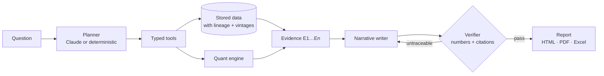

# Amaru

**A market analyst for U.S. grain and energy desks that shows its work.**

Ask Amaru about corn, soybeans, wheat, crude or natural gas and it writes a finished analysis with charts. Every number in it traces back to a USDA, CFTC, EIA or Federal Reserve release, and the report is checked before anyone sees it.

> **Status:** working MVP, getting ready for a design-partner pilot with U.S. ag lenders and grain merchandisers. It has no paying customers yet. Research and decision support only, not investment advice.

## The problem

Ag lenders, grain merchandisers and commodity advisers write a market view for someone else every week: a credit file, a note to growers, client commentary. Today they have two options:

- **Newsletters at $40–60 a month.** Every reader gets the same view, and you can't ask your own question.
- **Analyst services and research platforms.** These cost from about $950 a month to $10,000 or more a year per seat.

General AI chat sits in between, but its numbers aren't checked against official data. In this market both crop numbers and AI already have a trust problem.

Amaru goes after the gap: finished analysis that answers *your* question, at newsletter-plus prices, and you can audit every figure.

## The core design decision

**The LLM never computes a number.**

1. Claude plans the research and calls typed tools: about 30 of them, covering balance sheets, positioning, inventories, regressions, scenarios and more.
2. A deterministic quant engine does every calculation.
3. Each tool result becomes a numbered evidence item (E1…En).
4. Claude writes the narrative and cites that evidence.
5. A verifier pulls every number and citation out of the text and matches each one against the evidence. It allows rounding and unit conversions, such as % to basis points.
6. If any figure can't be traced, Claude gets one revision pass. Each report shows its verification result and lists any figures still untraced. A newsletter set to send automatically goes out only when verification passes.



Without Claude credentials, a deterministic planner and writer take over. The pipeline still runs end to end, and those reports restate the evidence without interpreting it.

## What it does

- **Research:** you ask a question and get a verified, cited report, with follow-up questions in the same thread. Five templates are built in: Daily Market Brief, Commodity Deep Dive, Global Macro Outlook, Country Intelligence and Cross-Asset Research. Reports can be in English, Spanish or Portuguese.
- **U.S. fundamentals:**
  - USDA supply-and-demand balance sheets since 1990, with stocks-to-use and the price it implies.
  - CFTC positioning, with crowding flags.
  - EIA weekly inventories against their 5-year range.
  - FOMC calendar, Fed and BEA releases, and a statement-by-statement reading of the Fed's tone.
- **Quant:** returns, volatility regimes (Markov switching), HAC regressions, event studies around Fed decisions, walk-forward forecasts judged against naive baselines, portfolio VaR and stress tests, and a scenario agent whose rules can be audited.
- **Monitoring:** alerts, monitoring agents that start research when something fires, weekly scheduled reports, a Monday digest, webhooks (Slack included) and a newsletter publisher.
- **SaaS plumbing:**
  - Workspaces, teams, plans and quotas, and Stripe billing.
  - Two-factor sign-in, API keys, an audit log and GDPR-style data export and deletion.
  - An operator console.

## Engineering highlights

- **Point-in-time data.** Revised macro values are stored as new vintages, so `as_of` queries reproduce exactly what was known on a past date. Every dataset carries its licence, source and freshness status.
- **Idempotent ingestion.** The pipeline stores raw payloads, runs quality checks, keeps watermarks and supports replay. It covers about ten public sources: FRED, USDA PSD, CFTC, EIA, BIS, World Bank, IMF, UN Comtrade and official press feeds. A source that renames a column or changes a unit fails the refresh instead of publishing a wrong number.
- **Restart-safe job queue.** Research runs wait in the database. Workers claim them with conditional updates and keep a heartbeat, and a run whose worker died is retried once. A lease row keeps more than one scheduler from running at a time.
- **Cost control for the LLM.** Each plan has a monthly Claude budget, tracked per run. Prompt caching cuts the repeated tool prefix to about 5% of the input price. When a question is asked again and the data hasn't changed, the earlier verified answer is reused.
- **Security.** Tokens and share links are stored as hashes. Two-factor seeds are encrypted at rest. Shared reports are served sandboxed by a Content-Security-Policy, and Stripe and outgoing webhooks are signed. Webhooks can't reach private addresses (SSRF protection). Backups are encrypted (AES-256-GCM) before they leave the server. See [SECURITY.md](SECURITY.md).
- **Measured, not claimed.** `atlas benchmark` checks the acceptance targets on live data: latency, how much of each answer traces to evidence, citation validity, reproducibility and isolation between workspaces. A walk-forward ML forecast is offered only when it beats the naive baselines, and on the current data it doesn't, as the reports say.

## Stack

| Layer | Choice |
|---|---|
| Backend | Python 3.12, FastAPI, SQLAlchemy, pandas, statsmodels, scikit-learn |
| LLM | Claude Opus 5.5 through the Anthropic SDK (tool use, prompt caching, effort control) |
| Data | SQLite for local development; PostgreSQL / TimescaleDB in production |
| Frontend | Next.js 15, React 19, TypeScript, lightweight-charts |
| Ops | Docker Compose, Caddy (automatic HTTPS), Prometheus metrics, encrypted off-site backups |
| CI | Tests on Python 3.12 and 3.13 and on Postgres, a web type-check and build, Docker images with an end-to-end smoke test, weekly dependency audits |

About 17,500 lines of Python and 6,400 of TypeScript, with roughly 225 tests. The tests include calculations checked by hand, verification against made-up numbers, and end-to-end research runs that must pass verification.

## Run it locally

```bash
python3 -m venv .venv && .venv/bin/pip install -e ".[dev]"
.venv/bin/atlas ingest          # create the database and pull public data (no API keys needed)
.venv/bin/atlas serve           # API on http://localhost:8010 (OpenAPI docs at /docs)
npm --prefix apps/web install && npm --prefix apps/web run dev   # web app on http://localhost:3010
```

Ask a question from the terminal:

```bash
.venv/bin/atlas research "Is the soybean balance sheet tightening, and what does that mean for prices into spring?"
```

To use Claude, set `ANTHROPIC_API_KEY`. Run the tests with `.venv/bin/python -m pytest`; they use an isolated database with synthetic data and need no network.

## Honest limitations

- **Public, delayed data.** Commodity prices are monthly benchmark averages, not CME or ICE futures, and nothing here is a tradable quote.
- **Gaps are disclosed, not filled.** There are no metals or cocoa fundamentals, no futures curves and no news wire. Research records each missing source as evidence of a gap.
- **No investment advice.** Amaru writes general research and never makes buy or sell calls.
- **AI can still reason badly about correct numbers.** Verification proves where the figures came from, not the quality of the argument. That is why every answer has right/wrong feedback buttons.

## Learn more

- [docs/reference.md](docs/reference.md): every feature, setting and operational detail
- [docs/deploy.md](docs/deploy.md): production on one server
- [docs/monetization.md](docs/monetization.md): pricing, target customers and what it would take to sell
- [SECURITY.md](SECURITY.md)

Amaru was called ATLAS, and internal names (the `atlas` package and CLI, `ATLAS_*` settings) keep the old name so existing setups keep working.
